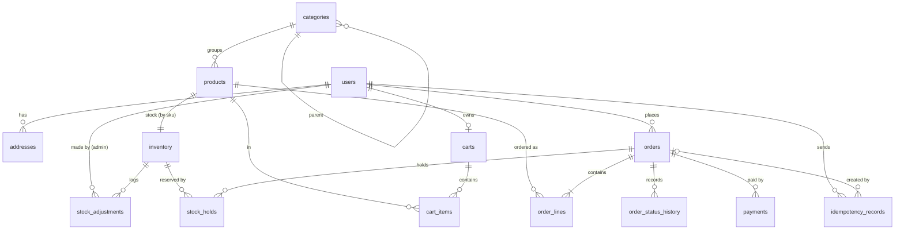

# Database

Everything for the E-Commerce POC database: schema `ecomm` with 14 tables, based on
`ecommerce_poc_specification.docx` (Parts 3 and 4), plus "day 1" sample data.

```
db/
├── docker-compose.yml          optional PostgreSQL in Docker (profile "docker", port 5432)
└── scripts/
    ├── ecomm-setup.sql         DDL: database ecomm_db, schema ecomm, 14 tables (re-runnable)
    ├── day1-sample-data.sql    DML: sample data for all 14 tables (re-runnable: empties them first)
    └── 99-drop-schema.sql      deletes schema ecomm with all tables and data
```

Everything uses the **`postgres` superuser, password `password`** (local dev only, no separate application login).

| Database | Port | App profile | How it's set up |
|---|---|---|---|
| PostgreSQL installed on this machine | **5433** | `local` (default) | Run the two scripts below once |
| PostgreSQL in Docker | **5432** | `docker` | Automatic: on first start the container runs `ecomm-setup.sql`, then `day1-sample-data.sql` |

## Local PostgreSQL (from the repo root, in PowerShell)

```powershell
$env:PGPASSWORD = 'password'   # or leave it out and type the password when psql asks
$psql = "C:\Program Files\PostgreSQL\18\bin\psql.exe"

# 1. Database, schema and tables (safe to re-run; existing objects are skipped)
& $psql -h localhost -p 5433 -U postgres -f db\scripts\ecomm-setup.sql

# 2. Day 1 sample data (safe to re-run; EMPTIES all ecomm tables first, then reloads)
& $psql -h localhost -p 5433 -U postgres -d ecomm_db -f db\scripts\day1-sample-data.sql

# Start over completely: drop the schema, then run 1 and 2 again
& $psql -h localhost -p 5433 -U postgres -d ecomm_db -f db\scripts\99-drop-schema.sql
```

On a second run of `ecomm-setup.sql` you'll see `NOTICE: ... already exists, skipping` lines; that's expected.

## Docker PostgreSQL

```powershell
docker compose -f db/docker-compose.yml up -d      # start (first start also loads schema + data)
docker compose -f db/docker-compose.yml down       # stop, keep data
docker compose -f db/docker-compose.yml down -v    # stop and DELETE data; next start rebuilds it
```

The scripts only run when the data volume is empty. To pick up script changes, use `down -v`.

## Tables

| Area | Tables |
|---|---|
| Auth | `users`, `addresses` |
| Catalog | `categories`, `products` |
| Inventory | `inventory`, `stock_adjustments` |
| Cart | `carts`, `cart_items` |
| Orders | `orders`, `order_lines`, `order_status_history` |
| Checkout support | `stock_holds`, `payments`, `idempotency_records` |



## Day 1 sample data

The shop's first day, 2026-10-21. All users log in with **`Password123!`** (stored as a bcrypt hash).

| Table | Rows | Highlights |
|---|---|---|
| `users` | 5 | `admin@example.com` (ADMIN); customers alice, bob, carol, dave (dave has no address yet) |
| `addresses` | 4 | alice has two (home is the default), bob and carol one each |
| `categories` | 5 | Kitchen, Home Office, Electronics → Accessories, Books |
| `products` | 12 | `ACC-3102` is DRAFT, `BOK-4002` DISCONTINUED; `ELE-3002`'s price rose 79.90 → 89.90 during the day |
| `inventory` | 12 | `OFF-2003` out of stock; `KIT-1003` has 1 unit, held by order 3 (0 available) |
| `stock_adjustments` | 13 | Morning restock, one CORRECTION (+1) and one DAMAGE (−2) |
| `carts` / `cart_items` | 3 / 4 | bob's keyboard was added at the old price (price-change flag); carol's cart has the discontinued book |
| `orders` | 6 | One each: CONFIRMED, SHIPPED, PENDING_PAYMENT, PAYMENT_FAILED, CANCELLED, DELIVERED |
| `order_lines` | 10 | Price snapshots; `line_total = unit_price × quantity` |
| `order_status_history` | 17 | The full path of every order, from checkout to its current status |
| `stock_holds` | 2 | Order 3's holds, which **expired** at 17:45, ready for the Stage 14 expiry job |
| `payments` | 7 | Successful charges, a TIMEOUT (order 3), a DECLINE (order 4), a REFUND (order 5) |
| `idempotency_records` | 6 | One stored checkout response per order |

**The numbers are consistent across tables:**
- order totals match their lines
- each order's status matches its last history entry
- `reserved` equals the held quantity
- `on_hand` equals the adjustments minus what was sold
- paid orders have a matching successful charge, and the cancelled order is fully refunded

The identity sequences are moved past the seed ids, so the next new row gets id 6, 13, ….

## Design decisions

- **Money is `numeric(12,2)`**, never floating point [SN-3]. `order_lines` checks `line_total = unit_price * quantity`.
- **Status, role and reason columns are `varchar` + `CHECK`**, not PostgreSQL `ENUM` types, so adding a value later is a one-line change and both ORMs map them as strings.
- **Snapshots:** `orders.ship_*` copies the address and `order_lines` copies SKU, name and price at checkout, so later changes never alter an order [SN-1, SN-2].
- **Integrity in the database, not only in code:** `reserved <= on_hand` [ST-4], one default address per user (partial unique index) [AD-2], a tracking number required once shipped [SM-3], one order per idempotency key [ID-2], unique SKUs and emails.
- **Every foreign key has an index**, because PostgreSQL doesn't create them automatically.
- **`version` columns** on `products`, `inventory` and `orders` support optimistic locking.
- **Products are never hard-deleted** once they appear in carts or orders (`ON DELETE RESTRICT`); set `status = 'DISCONTINUED'` instead [SN-4].

## How this relates to the apps

- This is the **target schema for the whole POC**. The apps grow into it stage by stage. For example, the Stage 2 product model still has an `active` flag, while this table has `status` (DRAFT / ACTIVE / DISCONTINUED) from Stage 5.
- At **Step 3.2 (migrations)**, the table section of `ecomm-setup.sql` can become the first migration of the one tool that owns the shared schema (e.g. Flyway `V1__create_tables.sql`), so the apps never fight over table creation.
